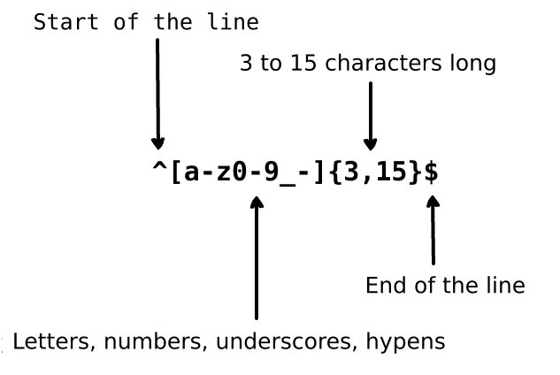

     
    

## Translations:

* [English](README.md)
* [German](translations/README-de.md)
* [Español](translations/README-es.md)
* [Français](translations/README-fr.md)
* [Italiano](translations/README-it.md)
* [Português do Brasil](translations/README-pt_BR.md)
* [中文版](translations/README-cn.md)
* [日本語](translations/README-ja.md)
* [한국어](translations/README-ko.md)
* [Turkish](translations/README-tr.md)
* [Greek](translations/README-gr.md)
* [Magyar](translations/README-hu.md)
* [Polish](translations/README-pl.md)
* [Русский](translations/README-ru.md)
* [Tiếng Việt](translations/README-vn.md)
* [Bahasa Indonesia](translations/README-id.md)
* [فارسی](translations/README-fa.md)
* [עברית](translations/README-he.md)

## What is Regular Expression?

    

> A regular expression is a group of characters or symbols which is used to find a specific pattern in a text.

A regular expression is a pattern that is matched against a subject string from
left to right. Regular expressions are used to replace text within a string, 
validate forms, extract a substring from a string based on a pattern match, 
and so much more. The term "regular expression" is a mouthful, so you will usually
find the term abbreviated to "regex" or "regexp". 

Imagine you are writing an application and you want to set the rules for when a
user chooses their username. We want to allow the username to contain letters,
numbers, underscores and hyphens. We also want to limit the number of characters
in the username so it does not look ugly. We can use the following regular expression to
validate the username:

  

  

The regular expression above can accept the strings `john_doe`, `jo-hn_doe` and
`john12_as`. It does not match `Jo` because that string contains an uppercase
letter and also it is too short.

> **Note:** Regular expression syntax differs slightly between engines (also
> called "flavors") such as PCRE, JavaScript, Python, Java, .NET and POSIX. This
> guide sticks to the PCRE-style syntax that most modern engines share, and most
> examples link to [regex101](https://regex101.com) so you can try them out. A few
> features, such as lookbehinds, are not available in every engine, so check the
> documentation of the language or tool you are using. Wikipedia has a
> [comparison of regular expression engines](https://en.wikipedia.org/wiki/Comparison_of_regular_expression_engines).

## Table of Contents

- [Basic Matchers](#1-basic-matchers)
- [Meta Characters](#2-meta-characters)
  - [The Full Stop](#21-the-full-stop)
  - [Character Sets](#22-character-sets)
    - [Negated Character Sets](#221-negated-character-sets)
  - [Repetitions](#23-repetitions)
    - [The Star](#231-the-star)
    - [The Plus](#232-the-plus)
    - [The Question Mark](#233-the-question-mark)
  - [Braces](#24-braces)
  - [Capturing Groups](#25-capturing-groups)
      - [Non-Capturing Groups](#251-non-capturing-groups)
      - [Named Capturing Groups](#252-named-capturing-groups)
  - [Alternation](#26-alternation)
  - [Escaping Special Characters](#27-escaping-special-characters)
  - [Anchors](#28-anchors)
    - [The Caret](#281-the-caret)
    - [The Dollar Sign](#282-the-dollar-sign)
    - [Word Boundaries](#283-word-boundaries)
- [Shorthand Character Sets](#3-shorthand-character-sets)
  - [Unicode Categories](#31-unicode-categories)
  - [POSIX Character Classes](#32-posix-character-classes)
- [Lookarounds](#4-lookarounds)
  - [Positive Lookahead](#41-positive-lookahead)
  - [Negative Lookahead](#42-negative-lookahead)
  - [Positive Lookbehind](#43-positive-lookbehind)
  - [Negative Lookbehind](#44-negative-lookbehind)
  - [Combining Lookarounds](#45-combining-lookarounds)
- [Flags](#5-flags)
  - [Case Insensitive](#51-case-insensitive)
  - [Global Search](#52-global-search)
  - [Multiline](#53-multiline)
  - [Single Line](#54-single-line)
  - [Inline Modifiers](#55-inline-modifiers)
- [Greedy vs Lazy Matching](#6-greedy-vs-lazy-matching)
- [Backreferences](#7-backreferences)
- [Catastrophic Backtracking](#8-catastrophic-backtracking)
- [Exercises](#9-exercises)
- [Further Reading](#further-reading)

## 1. Basic Matchers

A regular expression is just a pattern of characters that we use to perform a
search in a text.  For example, the regular expression `the` means: the letter
`t`, followed by the letter `h`, followed by the letter `e`.

<pre>
"the" => The fat cat sat on <a href="#learn-regex"><strong>the</strong></a> mat.
</pre>

[Test the regular expression](https://regex101.com/r/dmRygT/1)

In the examples throughout this guide, the matches are highlighted in the test
string. Unless an example shows its flags explicitly, as in `/the/g`, all the
matches are highlighted, as if the [global flag](#52-global-search) were set.

The regular expression `123` matches the string `123`. The regular expression is
matched against an input string by comparing each character in the regular
expression to each character in the input string, one after another. Regular
expressions are normally case-sensitive so the regular expression `The` would
not match the string `the`.

<pre>
"The" => <a href="#learn-regex"><strong>The</strong></a> fat cat sat on the mat.
</pre>

[Test the regular expression](https://regex101.com/r/1paXsy/1)

## 2. Meta Characters

Meta characters are the building blocks of regular expressions.  Meta
characters do not stand for themselves but instead are interpreted in some
special way. Some meta characters have a special meaning and are written inside
square brackets. The meta characters are as follows:

|Meta character|Description|
|:----:|----|
|.|Period matches any single character except a line break.|
|[ ]|Character class. Matches any character contained between the square brackets.|
|[^ ]|Negated character class. Matches any character that is not contained between the square brackets|
|*|Matches 0 or more repetitions of the preceding symbol.|
|+|Matches 1 or more repetitions of the preceding symbol.|
|?|Makes the preceding symbol optional.|
|{n,m}|Braces. Matches at least "n" but not more than "m" repetitions of the preceding symbol.|
|(xyz)|Character group. Matches the characters xyz in that exact order.|
|&#124;|Alternation. Matches either the characters before or the characters after the symbol.|
|&#92;|Escapes the next character. This allows you to match reserved characters <code>[ ] ( ) { } . * + ? ^ $ \ &#124;</code>|
|^|Matches the beginning of the input.|
|$|Matches the end of the input.|

## 2.1 The Full Stop

The full stop `.` is the simplest example of a meta character. The meta character `.`
matches any single character. It will not match return or newline characters.
For example, the regular expression `.ar` means: any character, followed by the
letter `a`, followed by the letter `r`.

<pre>
".ar" => The <a href="#learn-regex"><strong>car</strong></a> <a href="#learn-regex"><strong>par</strong></a>ked in the <a href="#learn-regex"><strong>gar</strong></a>age.
</pre>

[Test the regular expression](https://regex101.com/r/xc9GkU/1)

## 2.2 Character Sets

Character sets are also called character classes. Square brackets are used to
specify character sets. Use a hyphen inside a character set to specify the
characters' range. The order of the character range inside the square brackets
doesn't matter. For example, the regular expression `[Tt]he` means: an uppercase
`T` or lowercase `t`, followed by the letter `h`, followed by the letter `e`.

<pre>
"[Tt]he" => <a href="#learn-regex"><strong>The</strong></a> car parked in <a href="#learn-regex"><strong>the</strong></a> garage.
</pre>

[Test the regular expression](https://regex101.com/r/2ITLQ4/1)

A period inside a character set, however, means a literal period. The regular
expression `ar[.]` means: a lowercase character `a`, followed by the letter `r`,
followed by a period `.` character.

<pre>
"ar[.]" => A garage is a good place to park a c<a href="#learn-regex"><strong>ar.</strong></a>
</pre>

[Test the regular expression](https://regex101.com/r/wL3xtE/1)

### 2.2.1 Negated Character Sets

In general, the caret symbol represents the start of the string, but when it is
typed after the opening square bracket it negates the character set. For
example, the regular expression `[^c]ar` means: any character except `c`,
followed by the character `a`, followed by the letter `r`.

<pre>
"[^c]ar" => The car <a href="#learn-regex"><strong>par</strong></a>ked in the <a href="#learn-regex"><strong>gar</strong></a>age.
</pre>

[Test the regular expression](https://regex101.com/r/nNNlq3/1)

## 2.3 Repetitions

The meta characters `+`, `*` or `?` are used to specify how many times a
subpattern can occur. These meta characters act differently in different
situations.

### 2.3.1 The Star

The `*` symbol matches zero or more repetitions of the preceding matcher. The
regular expression `a*` means: zero or more repetitions of the preceding lowercase
character `a`. But if it appears after a character set or class then it finds
the repetitions of the whole character set. For example, the regular expression
`[a-z]*` means: any number of lowercase letters in a row.

<pre>
"[a-z]*" => T<a href="#learn-regex"><strong>he</strong></a> <a href="#learn-regex"><strong>car</strong></a> <a href="#learn-regex"><strong>parked</strong></a> <a href="#learn-regex"><strong>in</strong></a> <a href="#learn-regex"><strong>the</strong></a> <a href="#learn-regex"><strong>garage</strong></a> #21.
</pre>

[Test the regular expression](https://regex101.com/r/7m8me5/1)

The `*` symbol can be used with the meta character `.` to match any string of
characters `.*`. The `*` symbol can be used with the whitespace character `\s`
to match a string of whitespace characters. For example, the expression
`\s*cat\s*` means: zero or more spaces, followed by a lowercase `c`,
followed by a lowercase `a`, followed by a lowercase `t`,
followed by zero or more spaces.

<pre>
"\s*cat\s*" => The fat<a href="#learn-regex"><strong> cat </strong></a>sat on the con<a href="#learn-regex"><strong>cat</strong></a>enation.
</pre>

[Test the regular expression](https://regex101.com/r/gGrwuz/1)

### 2.3.2 The Plus

The `+` symbol matches one or more repetitions of the preceding character. For
example, the regular expression `c.+t` means: a lowercase `c`, followed by
at least one character, followed by a lowercase `t`. It needs to be
clarified that `t` is the last `t` in the sentence.

<pre>
"c.+t" => The fat <a href="#learn-regex"><strong>cat sat on the mat</strong></a>.
</pre>

[Test the regular expression](https://regex101.com/r/Dzf9Aa/1)

The difference between `+` and `*` shows when there may be nothing to repeat:
`ca*t` matches `ct`, `cat` and `caat`, whereas `ca+t` only matches `cat` and
`caat`.

### 2.3.3 The Question Mark

In regular expressions, the meta character `?` makes the preceding character
optional. This symbol matches zero or one instance of the preceding character.
For example, the regular expression `[T]?he` means: Optional uppercase
`T`, followed by a lowercase `h`, followed by a lowercase `e`.

<pre>
"[T]he" => <a href="#learn-regex"><strong>The</strong></a> car is parked in the garage.
</pre>

[Test the regular expression](https://regex101.com/r/cIg9zm/1)

<pre>
"[T]?he" => <a href="#learn-regex"><strong>The</strong></a> car is parked in t<a href="#learn-regex"><strong>he</strong></a> garage.
</pre>

[Test the regular expression](https://regex101.com/r/kPpO2x/1)

## 2.4 Braces

In regular expressions, braces (also called quantifiers) are used to
specify the number of times that a character or a group of characters can be
repeated. For example, the regular expression `[0-9]{2,3}` means: Match at least
2 digits, but not more than 3, ranging from 0 to 9.

<pre>
"[0-9]{2,3}" => The number was 9.<a href="#learn-regex"><strong>999</strong></a>7 but we rounded it off to <a href="#learn-regex"><strong>10</strong></a>.0.
</pre>

[Test the regular expression](https://regex101.com/r/juM86s/1)

We can leave out the second number. For example, the regular expression
`[0-9]{2,}` means: Match 2 or more digits. If we also remove the comma, the
regular expression `[0-9]{3}` means: Match exactly 3 digits.

<pre>
"[0-9]{2,}" => The number was 9.<a href="#learn-regex"><strong>9997</strong></a> but we rounded it off to <a href="#learn-regex"><strong>10</strong></a>.0.
</pre>

[Test the regular expression](https://regex101.com/r/Gdy4w5/1)

<pre>
"[0-9]{3}" => The number was 9.<a href="#learn-regex"><strong>999</strong></a>7 but we rounded it off to 10.0.
</pre>

[Test the regular expression](https://regex101.com/r/Sivu30/1)

## 2.5 Capturing Groups

A capturing group is a group of subpatterns that is written inside parentheses 
`(...)`. As discussed before, in regular expressions, if we put a quantifier 
after a character then it will repeat the preceding character. But if we put a quantifier
after a capturing group then it repeats the whole capturing group. For example,
the regular expression `(ab)*` matches zero or more repetitions of the character
"ab". We can also use the alternation `|` meta character inside a capturing group.
For example, the regular expression `(c|g|p)ar` means: a lowercase `c`,
`g` or `p`, followed by `a`, followed by `r`.

<pre>
"(c|g|p)ar" => The <a href="#learn-regex"><strong>car</strong></a> is <a href="#learn-regex"><strong>par</strong></a>ked in the <a href="#learn-regex"><strong>gar</strong></a>age.
</pre>

[Test the regular expression](https://regex101.com/r/tUxrBG/1)

Note that capturing groups do not only match, but also capture, the characters for use in 
the parent language. The parent language could be Python or JavaScript or virtually any
language that implements regular expressions in a function definition.

### 2.5.1 Non-Capturing Groups

A non-capturing group is a capturing group that matches the characters but 
does not capture the group. A non-capturing group is denoted by a `?` followed by a `:` 
within parentheses `(...)`. For example, the regular expression `(?:c|g|p)ar` is similar to 
`(c|g|p)ar` in that it matches the same characters but will not create a capture group.

<pre>
"(?:c|g|p)ar" => The <a href="#learn-regex"><strong>car</strong></a> is <a href="#learn-regex"><strong>par</strong></a>ked in the <a href="#learn-regex"><strong>gar</strong></a>age.
</pre>

[Test the regular expression](https://regex101.com/r/Rm7Me8/1)

Non-capturing groups can come in handy when used in find-and-replace functionality or 
when mixed with capturing groups to keep the overview when producing any other kind of output. 
See also [4. Lookarounds](#4-lookarounds).

### 2.5.2 Named Capturing Groups

Capturing groups are numbered from left to right, which gets hard to follow once
a regular expression has several of them. A capturing group can be given a name
instead by writing `?<name>` right after the opening parenthesis. For example,
the regular expression `(?<year>[0-9]{4})-(?<month>[0-9]{2})` means: four digits,
captured in a group named `year`, followed by a hyphen, followed by two digits,
captured in a group named `month`.

<pre>
"(?&lt;year>[0-9]{4})-(?&lt;month>[0-9]{2})" => The report is due on <a href="#learn-regex"><strong>2024-06</strong></a>.
</pre>

The parent language then gives access to the captured text by name. In
JavaScript, for example, `match.groups.year` is `2024` and `match.groups.month`
is `06`. Some languages use a slightly different syntax: Python writes named
groups as `(?P<name>...)`.

## 2.6 Alternation

In a regular expression, the vertical bar `|` is used to define alternation.
Alternation is like an OR statement between multiple expressions. Now, you may be
thinking that character sets and alternation work the same way. But the big
difference between character sets and alternation is that character sets work at the
character level but alternation works at the expression level. For example, the
regular expression `(T|t)he|car` means: either (an uppercase `T` or a lowercase
`t`, followed by a lowercase `h`, followed by a lowercase `e`) OR
(a lowercase `c`, followed by a lowercase `a`, followed by
a lowercase `r`). Note that I included the parentheses for clarity, to show that either expression
in parentheses can be met and it will match.

<pre>
"(T|t)he|car" => <a href="#learn-regex"><strong>The</strong></a> <a href="#learn-regex"><strong>car</strong></a> is parked in <a href="#learn-regex"><strong>the</strong></a> garage.
</pre>

[Test the regular expression](https://regex101.com/r/fBXyX0/1)

## 2.7 Escaping Special Characters

A backslash `\` is used in regular expressions to escape the next character. This
allows us to include reserved characters such as `{ } [ ] / \ + * . $ ^ | ?` as matching characters. To use one of these special character as a matching character, prepend it with `\`.

For example, the regular expression `.` is used to match any character except a
newline. Now, to match `.` in an input string, the regular expression
`(f|c|m)at\.?` means: a lowercase `f`, `c` or `m`, followed by a lowercase
`a`, followed by a lowercase `t`, followed by an optional `.`
character.

<pre>
"(f|c|m)at\.?" => The <a href="#learn-regex"><strong>fat</strong></a> <a href="#learn-regex"><strong>cat</strong></a> sat on the <a href="#learn-regex"><strong>mat.</strong></a>
</pre>

[Test the regular expression](https://regex101.com/r/DOc5Nu/1)

## 2.8 Anchors

In regular expressions, we use anchors to check if the matching symbol is the
starting symbol or ending symbol of the input string. Anchors are of two types:
The first type is the caret `^` that checks if the matching character is the first
character of the input and the second type is the dollar sign `$` which checks if a matching
character is the last character of the input string. In addition, the word
boundary `\b` checks if the match is at the beginning or the end of a word.

### 2.8.1 The Caret

The caret symbol `^` is used to check if a matching character is the first character
of the input string. If we apply the following regular expression `^a` (meaning 'a' must be
the starting character) to the string `abc`, it will match `a`. But if we apply
the regular expression `^b` to the above string, it will not match anything.
Because in the string `abc`, the "b" is not the starting character. Let's take a look
at another regular expression `^(T|t)he` which means: an uppercase `T` or
a lowercase `t` must be the first character in the string, followed by a
lowercase `h`, followed by a lowercase `e`.

<pre>
"(T|t)he" => <a href="#learn-regex"><strong>The</strong></a> car is parked in <a href="#learn-regex"><strong>the</strong></a> garage.
</pre>

[Test the regular expression](https://regex101.com/r/5ljjgB/1)

<pre>
"^(T|t)he" => <a href="#learn-regex"><strong>The</strong></a> car is parked in the garage.
</pre>

[Test the regular expression](https://regex101.com/r/jXrKne/1)

### 2.8.2 The Dollar Sign

The dollar sign `$` is used to check if a matching character is the last character
in the string. For example, the regular expression `(at\.)$` means: a
lowercase `a`, followed by a lowercase `t`, followed by a `.`
character and the matcher must be at the end of the string.

<pre>
"(at\.)" => The fat c<a href="#learn-regex"><strong>at.</strong></a> s<a href="#learn-regex"><strong>at.</strong></a> on the m<a href="#learn-regex"><strong>at.</strong></a>
</pre>

[Test the regular expression](https://regex101.com/r/y4Au4D/1)

<pre>
"(at\.)$" => The fat cat. sat. on the m<a href="#learn-regex"><strong>at.</strong></a>
</pre>

[Test the regular expression](https://regex101.com/r/t0AkOd/1)

Be careful when using `$` to validate input. In many engines (PCRE, Python, Java
and .NET among them, but not JavaScript) `$` also matches right before a line
break at the very end of the string, so `^[a-z]+$` accepts the string `abc`
followed by a line break as well. If that matters, use the anchor that only
matches at the very end of the string: `\z` in most engines, `\Z` in Python.

### 2.8.3 Word Boundaries

The word boundary `\b` matches a position rather than a character: the position
between a word character (`\w`) and a non-word character (`\W`), or between a
word character and the beginning or the end of the string. It is mostly used to
search for whole words. For example, the regular expression `\bfat\b` means: a
lowercase `f`, followed by a lowercase `a`, followed by a lowercase `t`, where
the match must be a word of its own and not a part of a longer word.

<pre>
"\bfat\b" => The <a href="#learn-regex"><strong>fat</strong></a> cat. sat. on the mat with the fatty rat.
</pre>

[Test the regular expression](https://regex101.com/r/y4Au4D/8)

If we only put a word boundary in front, the regular expression `\bfat` matches
every `fat` that is at the beginning of a word.

<pre>
"\bfat" => The <a href="#learn-regex"><strong>fat</strong></a> cat. sat. on the mat with the <a href="#learn-regex"><strong>fat</strong></a>ty cat.
</pre>

[Test the regular expression](https://regex101.com/r/nAOq0x/1)

The opposite is `\B`, which matches every position that is not a word boundary.

##  3. Shorthand Character Sets

There are a number of convenient shorthands for commonly used character sets/
regular expressions:

|Shorthand|Description|
|:----:|----|
|.|Any character except new line|
|\w|Matches alphanumeric characters and the underscore: `[a-zA-Z0-9_]`|
|\W|Matches everything except alphanumeric characters and the underscore: `[^\w]`|
|\d|Matches digits: `[0-9]`|
|\D|Matches non-digits: `[^\d]`|
|\s|Matches whitespace characters: `[\t\n\f\r\p{Z}]`|
|\S|Matches non-whitespace characters: `[^\s]`|

### 3.1 Unicode Categories

A character set such as `[a-zA-Z]` only covers the letters of the English
alphabet. To match letters of any language, we can use Unicode categories, which
are written `\p{...}`. For example, `\p{L}` matches any kind of letter from any
language.

|Shorthand|Description|
|:----:|----|
|\p{L}|Matches any letter|
|\p{Lu}|Matches any uppercase letter|
|\p{Ll}|Matches any lowercase letter|
|\p{N}|Matches any kind of number|
|\p{P}|Matches any punctuation character|
|\p{Z}|Matches any separator, such as a space or a non-breaking space, but not a tab or the line break characters `\n` and `\r`|
|\P{L}|Matches anything that is not a letter (an uppercase `P` negates the category)|

For example, the regular expression `\p{L}+` means: one or more letters in a row.

<pre>
"\p{L}+" => <a href="#learn-regex"><strong>naïve</strong></a> <a href="#learn-regex"><strong>café</strong></a> <a href="#learn-regex"><strong>東京</strong></a> 42
</pre>

Unicode categories are supported by PCRE, Java, .NET, Ruby and Go. JavaScript
supports them when the `u` flag is set, as in `/\p{L}+/gu`. Python's built-in
`re` module does not support them.

### 3.2 POSIX Character Classes

POSIX character classes are another way to write commonly used character sets.
They are written `[:name:]` and are only valid inside the square brackets of a
character set, so the regular expression that matches a digit is `[[:digit:]]`.
They can be combined with other characters in the same set: `[[:alpha:]_]`
matches a letter or an underscore.

|Class|Description|
|:----:|----|
|[:alpha:]|Letters|
|[:digit:]|Digits|
|[:alnum:]|Letters and digits|
|[:upper:]|Uppercase letters|
|[:lower:]|Lowercase letters|
|[:space:]|Whitespace characters|
|[:punct:]|Punctuation characters|
|[:xdigit:]|Hexadecimal digits: `[0-9a-fA-F]`|

<pre>
"[[:digit:]]+" => The number was <a href="#learn-regex"><strong>9</strong></a>.<a href="#learn-regex"><strong>9997</strong></a> but we rounded it off to <a href="#learn-regex"><strong>10</strong></a>.<a href="#learn-regex"><strong>0</strong></a>.
</pre>

POSIX character classes are supported by PCRE, Ruby and the POSIX tools such as
`grep`, `sed` and `awk`. They are not available in JavaScript, Python, Java or
.NET.

## 4. Lookarounds

Lookbehinds and lookaheads (also called lookarounds) are specific types of
***non-capturing groups*** (used to match a pattern but without including it in the matching
list). Lookarounds are used when a pattern must be
preceded or followed by another pattern. For example, imagine we want to get all
numbers that are preceded by the `$` character from the string
`$4.44 and $10.88`. We will use the following regular expression `(?<=\$)[0-9\.]*`
which means: get all the numbers which contain the `.` character and are preceded
by the `$` character. These are the lookarounds that are used in regular
expressions:

|Symbol|Description|
|:----:|----|
|?=|Positive Lookahead|
|?!|Negative Lookahead|
|?<=|Positive Lookbehind|
|?<!|Negative Lookbehind|

Note that lookbehinds are not supported by every regular expression engine.
JavaScript, for example, has only supported them since ES2018, and older
browsers (such as Safari before version 16.4, which includes every browser on
iOS before 16.4) fail to parse a regular expression that contains a lookbehind.

### 4.1 Positive Lookahead

The positive lookahead asserts that the first part of the expression must be
followed by the lookahead expression. The returned match only contains the text
that is matched by the first part of the expression. To define a positive
lookahead, parentheses are used. Within those parentheses, a question mark with
an equals sign is used like this: `(?=...)`. The lookahead expression is written after
the equals sign inside parentheses. For example, the regular expression
`(T|t)he(?=\sfat)` means: match either a lowercase `t` or an uppercase
 `T`, followed by the letter `h`, followed by the letter `e`. In parentheses we
define a positive lookahead which tells the regular expression engine to match `The`
or `the` only if it's followed by a whitespace character and the word `fat`.

<pre>
"(T|t)he(?=\sfat)" => <a href="#learn-regex"><strong>The</strong></a> fat cat sat on the mat.
</pre>

[Test the regular expression](https://regex101.com/r/IDDARt/1)

### 4.2 Negative Lookahead

Negative lookaheads are used when we need to get all matches from an input string
that are not followed by a certain pattern. A negative lookahead is written the same way as a
positive lookahead. The only difference is, instead of an equals sign `=`, we
use an exclamation mark `!` to indicate negation i.e. `(?!...)`. Let's take a look at the following
regular expression `(T|t)he(?!\sfat)` which means: get all `The` or `the` words
from the input string that are not followed by a space character and the word `fat`.

<pre>
"(T|t)he(?!\sfat)" => The fat cat sat on <a href="#learn-regex"><strong>the</strong></a> mat.
</pre>

[Test the regular expression](https://regex101.com/r/V32Npg/1)

### 4.3 Positive Lookbehind

Positive lookbehinds are used to get all the matches that are preceded by a
specific pattern. Positive lookbehinds are written `(?<=...)`. For example, the
regular expression `(?<=(T|t)he\s)(fat|mat)` means: get all `fat` or `mat` words
from the input string that come after the word `The` or `the`.

<pre>
"(?&lt;=(T|t)he\s)(fat|mat)" => The <a href="#learn-regex"><strong>fat</strong></a> cat sat on the <a href="#learn-regex"><strong>mat</strong></a>.
</pre>

[Test the regular expression](https://regex101.com/r/avH165/1)

### 4.4 Negative Lookbehind

Negative lookbehinds are used to get all the matches that are not preceded by a
specific pattern. Negative lookbehinds are written `(?<!...)`. For example, the
regular expression `(?<!(T|t)he\s)(cat)` means: get all `cat` words from the input
string that are not after the word `The` or `the`.

<pre>
"(?&lt;!(T|t)he\s)(cat)" => The cat sat on <a href="#learn-regex"><strong>cat</strong></a>.
</pre>

[Test the regular expression](https://regex101.com/r/8Efx5G/1)

### 4.5 Combining Lookarounds

A lookaround only checks its pattern and does not move forward in the input
string. This means that several lookarounds can be placed at the same position,
and all of them have to succeed, which works like an AND between conditions. For
example, the regular expression `^(?=.*[0-9])(?=.*[a-z]).{8,}$` means: from the
beginning of the line, there must be a digit somewhere ahead, AND there must be a
lowercase letter somewhere ahead, and the line must be at least 8 characters
long.

<pre>
"/^(?=.*[0-9])(?=.*[a-z]).{8,}$/gm" => password
                                       <a href="#learn-regex"><strong>passw0rd</strong></a>
                                       12345678
</pre>

## 5. Flags

Flags are also called modifiers because they modify the output of a regular
expression. These flags can be used in any order or combination, and are an
integral part of the RegExp.

|Flag|Description|
|:----:|----|
|i|Case insensitive: Match will be case-insensitive.|
|g|Global Search: Match all instances, not just the first.|
|m|Multiline: Anchor meta characters work on each line.|
|s|Single line: The full stop also matches line breaks.|

### 5.1 Case Insensitive

The `i` modifier is used to perform case-insensitive matching. For example, the
regular expression `/The/gi` means: an uppercase `T`, followed by a lowercase
`h`, followed by an `e`. And at the end of regular expression
the `i` flag tells the regular expression engine to ignore the case. As you can
see, we also provided `g` flag because we want to search for the pattern in the
whole input string.

<pre>
"The" => <a href="#learn-regex"><strong>The</strong></a> fat cat sat on the mat.
</pre>

[Test the regular expression](https://regex101.com/r/dpQyf9/1)

<pre>
"/The/gi" => <a href="#learn-regex"><strong>The</strong></a> fat cat sat on <a href="#learn-regex"><strong>the</strong></a> mat.
</pre>

[Test the regular expression](https://regex101.com/r/ahfiuh/1)

### 5.2 Global Search

The `g` modifier is used to perform a global match (finds all matches rather than
stopping after the first match). For example, the regular expression `/.(at)/g`
means: any character except a new line, followed by a lowercase `a`,
followed by a lowercase `t`. Because we provided the `g` flag at the end of
the regular expression, it will now find all matches in the input string, not just the first one (which is the default behavior).

<pre>
"/.(at)/" => The <a href="#learn-regex"><strong>fat</strong></a> cat sat on the mat.
</pre>

[Test the regular expression](https://regex101.com/r/jnk6gM/1)

<pre>
"/.(at)/g" => The <a href="#learn-regex"><strong>fat</strong></a> <a href="#learn-regex"><strong>cat</strong></a> <a href="#learn-regex"><strong>sat</strong></a> on the <a href="#learn-regex"><strong>mat</strong></a>.
</pre>

[Test the regular expression](https://regex101.com/r/dO1nef/1)

### 5.3 Multiline

The `m` modifier is used to perform a multi-line match. As we discussed earlier,
anchors `(^, $)` are used to check if a pattern is at the beginning of the input or
the end. But if we want the anchors to work on each line, we use
the `m` flag. For example, the regular expression `/.at(.)?$/gm` means: any
character except a new line, followed by a lowercase `a`, followed by a
lowercase `t` and, optionally, anything except a new line. And because of the
`m` flag, the regular expression engine now matches patterns at the end of each
line in a string.

<pre>
"/.at(.)?$/" => The fat
                cat sat
                on the <a href="#learn-regex"><strong>mat.</strong></a>
</pre>

[Test the regular expression](https://regex101.com/r/hoGMkP/1)

<pre>
"/.at(.)?$/gm" => The <a href="#learn-regex"><strong>fat</strong></a>
                  cat <a href="#learn-regex"><strong>sat</strong></a>
                  on the <a href="#learn-regex"><strong>mat.</strong></a>
</pre>

[Test the regular expression](https://regex101.com/r/E88WE2/1)

### 5.4 Single Line

As we discussed earlier, the full stop `.` matches any character except a line
break. The `s` modifier (also called "dot all") makes the full stop match line
breaks too, so that a pattern such as `.*` can continue across several lines.
For example, the regular expression `/The.*mat/s` means: `The`, followed by any
number of any characters including line breaks, followed by `mat`.

<pre>
"/The.*mat/" => The fat
                cat sat on the mat.
</pre>

<pre>
"/The.*mat/s" => <a href="#learn-regex"><strong>The fat</strong></a>
                 <a href="#learn-regex"><strong>cat sat on the mat</strong></a>.
</pre>

### 5.5 Inline Modifiers

Instead of adding a flag after the closing delimiter, most engines also allow
turning a modifier on inside the regular expression itself. This is useful when
the regular expression is passed around as a plain string, for example in a
configuration file. An inline modifier is written at the beginning of the
regular expression as a question mark followed by the flag letters within
parentheses: `(?i)`, `(?m)`, `(?s)`, or combined as in `(?im)`. For example, the regular expression `(?i)the` means the same as `/the/i`.

<pre>
"/(?i)the/g" => <a href="#learn-regex"><strong>The</strong></a> fat cat sat on <a href="#learn-regex"><strong>the</strong></a> mat.
</pre>

A modifier can also be applied to just a part of the regular expression by
writing that part after a colon within the same parentheses. For example, in the
regular expression `(?i:t)he` only the letter `t` is case-insensitive.

Inline modifiers are supported by PCRE, Python, Java, .NET and Go. JavaScript
does not support the `(?i)` form, and only recent JavaScript engines support
the form that applies to a part of the regular expression, such as `(?i:t)he`.
Also note that the global flag `g` cannot be
written inline, because it tells the parent language how to use the regular
expression rather than changing what the regular expression matches.

## 6. Greedy vs Lazy Matching

By default, a regex will perform a greedy match, which means the match will be as long as
possible. We can use `?` to match in a lazy way, which means the match should be as short as possible.
The `?` is placed directly after a quantifier, so `*?`, `+?`, `??` and `{2,3}?` are the lazy
versions of `*`, `+`, `?` and `{2,3}`.

<pre>
"/(.*at)/" => <a href="#learn-regex"><strong>The fat cat sat on the mat</strong></a>.
</pre>

[Test the regular expression](https://regex101.com/r/AyAdgJ/1)

<pre>
"/(.*?at)/" => <a href="#learn-regex"><strong>The fat</strong></a> cat sat on the mat.
</pre>

[Test the regular expression](https://regex101.com/r/AyAdgJ/2)

Lazy matching becomes even more useful together with the global flag, because
every match then ends as early as possible:

<pre>
"/(fa.*?at)/g" => The <a href="#learn-regex"><strong>fat cat</strong></a> sat on the mat and another <a href="#learn-regex"><strong>fat cat</strong></a> got jealous.
</pre>

[Test the regular expression](https://regex101.com/r/hxE4kq/1)

Without the `?`, the greedy version matches everything from the first `fa` to the last `at`:

<pre>
"/(fa.*at)/g" => The <a href="#learn-regex"><strong>fat cat sat on the mat and another fat cat</strong></a> got jealous.
</pre>

## 7. Backreferences

A backreference matches the same text that was matched earlier by a
[capturing group](#25-capturing-groups). Capturing groups are numbered from left
to right, starting at 1, so `\1` refers to the text captured by the first group,
`\2` to the text captured by the second group, and so on. For example, the
regular expression `([a-z])\1` means: a lowercase letter, followed by the very
same letter again. It finds all the doubled letters.

<pre>
"/([a-z])\1/g" => Ha<a href="#learn-regex"><strong>pp</strong></a>ine<a href="#learn-regex"><strong>ss</strong></a>
</pre>

[Test the regular expression](https://regex101.com/r/5Nclso/1)

The regular expression `(\")(.*?)\1` means: a double quote, followed by as few
characters as possible, followed by whatever the first group matched, which is
the closing double quote.

<pre>
"/(\")(.*?)\1/" => He said <a href="#learn-regex"><strong>"She's beautiful"</strong></a>
</pre>

[Test the regular expression](https://regex101.com/r/ykVPb4/1)

Captured groups can also be used in the replacement text of a find-and-replace
operation, where they are usually written as `$1`, `$2` (or `\1`, `\2`, depending
on the language). In JavaScript, for example,
`"John Smith".replace(/(\w+)\s(\w+)/, "$2, $1")` returns `Smith, John`.

## 8. Catastrophic Backtracking

Most regular expression engines work by backtracking: when one way of matching
the input fails, the engine goes back and tries the next possible way. Usually
this is fast, but some regular expressions can be matched against the same input
in an enormous number of ways, and the engine may try them all before it gives
up. This is called catastrophic backtracking.

The classic example is the regular expression `^(a+)+$`, which has a quantifier
inside a group that is repeated by another quantifier. Applied to a string of
`a` characters followed by a `!`, it can never match, but the engine first tries
every possible way of dividing the `a` characters between the inner and the
outer `+`. Each additional `a` doubles the amount of work: with 20 `a`
characters the answer is instant, with 30 it can take seconds, and with 40 it
can take hours.

<pre>
"^(a+)+$" => aaaaaaaaaaaaaaaaaaaaaaaaaaaaaa!
</pre>

If such a regular expression is applied to input that comes from a user, a
single short string can keep a server busy for a very long time. This kind of
attack is known as Regular expression Denial of Service
([ReDoS](https://owasp.org/www-community/attacks/Regular_expression_Denial_of_Service_-_ReDoS)).
To avoid it:

* Do not put a quantifier on a group that itself ends in a quantifier, such as
  `(a+)+` or `(.*a)*`. Here `a+` matches exactly the same strings as `(a+)+`.
* Make sure the alternatives of a repeated group cannot match the same text,
  unlike in `(a|aa)+`.
* Limit the length of the input before applying the regular expression.
* For untrusted input, consider an engine that does not backtrack and always
  runs in linear time, such as RE2 or the engines of Go and Rust. These engines
  do not support backreferences and lookarounds.

## 9. Exercises

Try to write a regular expression for each of the following tasks before you
look at the solution. There is often more than one correct answer.

**1.** Match the word `cat` only where it is a word of its own.

<pre>
The <a href="#learn-regex"><strong>cat</strong></a> sat on the concatenation with another <a href="#learn-regex"><strong>cat</strong></a>.
</pre>

Solution

`\bcat\b` uses a [word boundary](#283-word-boundaries) on both sides, so the
`cat` in `concatenation` is not matched.

**2.** Check that a string is a hexadecimal color code: a `#` followed by
exactly three or exactly six hexadecimal digits. It should accept `#1a2b3c` and
`#FFF`, but not `#12`, `#1234`, `#12345g` or `1a2b3c`.

Solution

`^#([0-9a-fA-F]{3}|[0-9a-fA-F]{6})$` combines [anchors](#28-anchors),
[character sets](#22-character-sets), [braces](#24-braces) and
[alternation](#26-alternation). The anchors make sure that nothing comes before
or after the color code. Remember from [2.8.2](#282-the-dollar-sign) that in
many engines `$` still accepts a line break at the very end of the string. To
rule that out, replace the `$` with `\z` (`\Z` in Python).

**3.** Check that a string has the format of a date written as `YYYY-MM-DD`. It
should accept `2024-06-30`, but not `2024-6-30`, `24-06-30` or `2024/06/30`.

Solution

`^\d{4}-\d{2}-\d{2}$` uses the [shorthand](#3-shorthand-character-sets) `\d`
for a digit. Note that it only checks the format, so it also accepts
`2024-99-99`. As in the previous exercise, use `\z` instead of `$` if a line
break at the end of the string must be rejected.

**4.** Find all the prices, without the `$` character in front of them.

<pre>
Coffee costs $<a href="#learn-regex"><strong>4.50</strong></a>, tea costs $<a href="#learn-regex"><strong>3</strong></a> and 12 cookies cost $<a href="#learn-regex"><strong>10.88</strong></a>.
</pre>

Solution

`(?<=\$)\d+(\.\d{2})?` uses a [positive lookbehind](#43-positive-lookbehind)
to require the `$` without including it in the match, which is why `12` is not
matched. The group with the `?` makes the cents optional.

**5.** Find the words that were typed twice in a row by accident.

<pre>
It was <a href="#learn-regex"><strong>the the</strong></a> best of times, it <a href="#learn-regex"><strong>was was</strong></a> the worst of times.
</pre>

Solution

`\b(\w+)\s+\1\b` captures a word in a group and uses the
[backreference](#7-backreferences) `\1` to require the same word again after
some whitespace.

**6.** Match each HTML tag on its own.

<pre>
<a href="#learn-regex"><strong>&lt;b></strong></a>bold<a href="#learn-regex"><strong>&lt;/b></strong></a> and <a href="#learn-regex"><strong>&lt;i></strong></a>italic<a href="#learn-regex"><strong>&lt;/i></strong></a>
</pre>

Solution

`<.+?>` uses a [lazy](#6-greedy-vs-lazy-matching) quantifier. The greedy `<.+>`
would produce a single match from the first `<` to the last `>`. Another
solution is `<[^>]+>`, which uses a
[negated character set](#221-negated-character-sets).

Both solutions only work for simple markup like the one above. In a tag such as
`<a title="1 > 0">`, they stop at the `>` inside the attribute. To process real
HTML, use an HTML parser instead of a regular expression.

## Further Reading

Regular expressions come from the theory of formal languages. A regular
expression in the original, mathematical sense describes a
[regular language](https://en.wikipedia.org/wiki/Regular_language), and such an
expression can be turned into a finite automaton that checks any input in a
time proportional to the length of the input. Backreferences go beyond that
theory: with them, a regular expression can describe languages that are not
regular, and those cannot be checked by a finite automaton. This is one of the
reasons why most engines use backtracking instead.

* [Regular Expression Matching Can Be Simple And Fast](https://swtch.com/~rsc/regexp/regexp1.html)
  by Russ Cox explains how finite automata are used to match regular
  expressions.
* [Regular-Expressions.info](https://www.regular-expressions.info/) is a
  detailed reference that also covers the differences between the engines, for
  example for [Unicode](https://www.regular-expressions.info/unicode.html),
  [POSIX character classes](https://www.regular-expressions.info/posixbrackets.html)
  and [catastrophic backtracking](https://www.regular-expressions.info/catastrophic.html).
* [regex101](https://regex101.com) lets you test and debug regular expressions
  and explains each part of them.

## Contribution

* Open a pull request with improvements
* Discuss ideas in issues
* Spread the word

## License

MIT &copy; Zeeshan Ahmad
